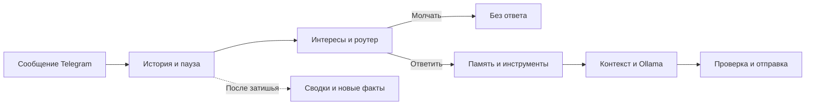

# Byamka

**Byamka — Telegram-бот с настраиваемым характером, памятью и интересами,
работающий через Ollama.**

Он может общаться в личных сообщениях и участвовать в групповой переписке:
учитывать предыдущие реплики, запоминать факты, реагировать на обращения и
выбирать,
стоит ли включаться в разговор без явного вызова.

Стиль общения задаётся системной инструкцией и примерами диалогов.
Память и интересы сохраняются между перезапусками. Модели запускаются на
сервере
Ollama, указанном в конфиге; SQLite и локальный Qdrant хранят данные на диске.

## Что умеет бот

| Возможность                           | Как это работает                                                                                                   |
|---------------------------------------|--------------------------------------------------------------------------------------------------------------------|
| Общение в личных сообщениях и группах | Отвечает на прямые обращения; для остальных сообщений оценивает уместность реакции.                                |
| Продолжение разговора                 | Может распознать следующую реплику того же собеседника без повторного упоминания, пока не истекло окно диалога.    |
| Характер и стиль речи                 | Имя, дополнительные имена, personality и демонстрационные диалоги задаются в YAML.                                 |
| Контекст переписки                    | Передаёт модели историю с отдельными ролями пользователя и бота, авторами и связями reply.                         |
| Сжатие истории                        | Работает по принципу контекстного окна, при исчерпании бюджета происходит сжатии истории.                          |
| Долговременная память                 | Сохраняет факты вручную через команду или автоматически; ищет их по смыслу с помощью embeddings.                   |
| Интересы для каждого чата             | Сочетает воспроизводимые предпочтения по seed с выученными темами, новизной и штрафами за повторы.                 |
| Изображения                           | При совместимой модели анализирует картинки, сохраняет их и создаёт описания для памяти.                           |
| Инструменты                           | Может вызвать калькулятор или дополнительный поиск по памяти перед ответом.                                        |
| Импорт переписки                      | Загружает текстовый Telegram Desktop JSON export, создаёт сводки, факты и темы интересов.                          |
| Обработка серии сообщений             | Ждёт короткую паузу после последней реплики, объединяет ожидающие обычные сообщения, сохраняя их в истории.        |
| Защита от повторов                    | Проверяет подозрительное повторение текста, может перегенерировать ответ и подавить повторный неудачный результат. |

Используется In-Context Learning:
адаптация происходит через контекст, сохранённые факты и оценки интересов.
Голосовые сообщения, расшифровка аудио, видео и веб-поиск сейчас не
реализованы.

## Основной интерес в создании бота

Сейчас большинство llm обучаются как агенты: кодинг, выполнение задач,
следование инструкциям. Стиль общения таких моделей - ассистент.
Я же хотел добиться ощущения полноценного участника чата, со своими интересами
и с хорошим стилем общения.
Один из известных примеров такого бота - это "Сглыпа".

Эта задача делится на две составляющих:

1) Скафолдинг - создание обвязки вокруг модели, для работы в рамках Telegram
   инфраструктуры.
2) Поведение бота. Как заставить модель перестать быть ассистентом и ввести
   себя более живо.

Этап скафолдинга довольно понятен, потребовались некоторые эксперименты и
исправления, но сейчас обвязка работает хорошо.
Такие вещи как контекстное окно, использование инструментов, RAG память
довольно понятны.
Основную проблему, которую пришлось решать - это роутер. В отличии от бота
ассистента, бот не должен отвечать на каждое сообщение.
Поэтому был создан специальный модуль, который анализирует контекст и решат,
стоит ли вступать боту в диалог или нет.

Работа с поведением же была самой сложной. Сначала я использовал модели
семейства Qwen, они ведут себя именно как ассистенты. Очень сухой и
неинтересный стиль общения.
Но я попытался это исправить.

Первая попытка решения - игра с системным промптом: добавление таких
прилагательных, как "смешной", "дружелюбный", "не наивный", не давали
существенного результата.
То есть я пытался задать боту стиль общения и интересы через описание того,
каким он должен быть. Для модели это мало чего дает, результат получается
слабым.

**Вторая попытка** - добавление движка интересов. Он работает примерно так:

1) Получение смысла сообщения. Текст отправляется в embedding-модель. Она
   возвращает числовой вектор, по которому можно сравнивать сообщения по
   смыслу.

2) Расчёт врождённых предпочтений. Вектор проецируется в небольшое
   пространство — по умолчанию из шести измерений. В этой точке вычисляются
   несколько плавных шумовых полей, зависящих от seed. Поэтому близкие
   сообщения обычно вызывают похожую реакцию, а одинаковые настройки дают
   воспроизводимые предпочтения.

3) Поиск знакомых тем. В SQLite находятся похожие темы этого чата. Их
   сохранённые оценки дают выученный интерес. В разных чатах он развивается
   независимо.

4) Оценка новизны и повторяемости. Новая тема получает прибавку. Часто
   встречающаяся становится менее новой. Недавно обсуждавшаяся получает
   дополнительный штраф, который постепенно исчезает за время
   topic_cooldown_minutes.

5) Сохранение наблюдения и обновление темы. Достаточно значимая новая тема
   записывается в базу. Для знакомой темы обновляются её смысловой центр, число
   появлений и выученный интерес.

Итоговая формула рассчитывается так:

```
интерес =
    базовый уровень
  + ограниченный вклад врождённого предпочтения
  + выученный интерес × вес
  + поправка на новизну
  − штраф за недавний повтор
```

Роутер учитывает эти параметры при оценке надобности ответа. Таким образом бот
как бы получает врожденные интересы к некоторым темам.
Но в реализации есть много костылей, а также это не влияет на стиль ответа.
Поэтому можно считать, что это добавление чуть улучшает поведение бота. Это
кандидат на переделку.

На этом этапе бот общался очень слабо, никакой субъектности и осмысленности в
его общении не было. Он вел себя очень глупо, постоянно галлюцинировал,
сообщения были сухими и бессвязными.

В этом поведение прослеживается не только недостаточная настройка, можно
увидеть, что не хватает мощности модели.
Действительно, до этого я пользовался компьютером с 8 ГБ видеопамяти, у модели
был контекст 8 тысяч токенов на все: на системный промпт, на ризонинг, на
инструкции по чтению и обработке сообщений и прочее. Это мало.
Поэтому я переехал на сервер с 22 ГБ видео памяти, далее поднял контекст до 40
тысяч токенов и начал использовать модели от 18 до 30 миллиардов параметров с
квантизацией.

Это радикально улучшило качество ответов. В этот момент я вспомнил о такой
модели Kimi K2. Ее высоко оценивали за живой литературный стиль, а также за
ритм текста.
Поэтому я решил поискать модели с более живым стилем письма, чем Qwen. Были
протестированы 26 моделей, например: модели семейства Qwen с дообучением, Gemma
3 и Gemma 4 обычная и с дообучением. Так же я протестировал GLM 4.7 Flash Uncensored и некоторые другие модели.
Выбор в итоге пал на Gemma 4 26B A4B IT, Unsloth в UD-IQ4_XS. Модель показала очень хороший интеллект, обработку контекста, следование инструкциям. Стиль письма оказался отличным, модель подстраивается под стиль общения, может острить и шутить.
Также плюсом является то, что это MoE модель, из-за этого скорость генерации токенов в 1.5 - 2 раза выше, чем на плотных моделях того же размера.

Далее я добавил модели в системный промпт примеры настоящих диалогов из чата, где имя одного из участников было заменено на имя бота. Это радикально улучшило качества ответа.

## Содержание

- [Как обрабатывается сообщение](#message-flow)
- [Установка и первый запуск](#installation)
- [Команды Telegram](#commands)
- [Подробная документация](#documentation)

<a id="message-flow"></a>

## Как обрабатывается сообщение

1. Бот сохраняет поступившее сообщение и ждёт настроенную паузу между
   репликами.
2. Движок интересов оценивает тему, а роутер выбирает: ответить, уточнить,
   использовать инструменты или промолчать.
3. Для ответа извлекаются тематические факты и правила поведения. При
   необходимости роутер пересматривает решение после поиска.
4. Планировщик вызывает доступные инструменты, если они нужны.
5. В пределах токенного бюджета собираются personality, примеры, сводки,
   память, история и текущее сообщение.
6. Модель генерирует ответ; приложение очищает reasoning, проверяет повторы,
   ограничивает длину и отправляет сообщение.
7. После затишья фоновая очередь описывает изображения, сжимает историю и
   извлекает новые факты.



Один чат обрабатывается последовательно. Новые входящие сообщения сохраняются,
пока предыдущий ответ генерируется. Уже начатая генерация не отменяется из-за
новой реплики.
Число вызовов модели на сообщение зависит от роутера, памяти, инструментов и
фоновых задач.

<a id="installation"></a>

## Установка и первый запуск

### Требования

- Python 3.11 или 3.12; проверка текущей публичной конфигурации выполнялась на
  Python 3.12.
- Запущенная [Ollama](https://ollama.com/) с доступом к `/api/chat` и
  embeddings API.
- Достаточно оперативной памяти и, при использовании GPU, видеопамяти для
  выбранной модели и контекстного окна.
- Токен Telegram-бота. Создать бота можно
  через [BotFather](https://t.me/BotFather).

Отдельный сервер Qdrant не нужен: используется встроенный локальный режим.
Бот получает сообщения через long polling; публичный HTTP-сервер и webhook для
запуска не требуются.

### 1. Подготовь окружение

Склонируй репозиторий или скачай исходники и перейди в их корневой каталог.
Все следующие команды выполняются из корня проекта.

```sh
python -m venv .venv
```

PowerShell:

```powershell
.\.venv\Scripts\Activate.ps1
```

Linux/macOS:

```sh
source .venv/bin/activate
```

Установи зависимости:

```sh
python -m pip install -r requirements.txt
```

### 2. Создай рабочие настройки

PowerShell:

```powershell
Copy-Item .env.example .env
Copy-Item config/config.example.yaml config/config.yaml
```

Linux/macOS:

```sh
cp .env.example .env
cp config/config.example.yaml config/config.yaml
```

Эти команды предназначены для первой установки; не перезаписывай ими уже
настроенные файлы.
В `.env` заполни переменную `TELEGRAM_BOT_TOKEN` токеном от BotFather.
В `config/config.yaml` задай модели и нужное поведение.
Публичный `config/config.example.yaml` содержит полный набор полей с
комментариями.
Подробности настройки описаны в [руководстве](docs/GUIDE.md#configuration).

### 3. Подготовь модели

Стартовый шаблон использует следующие модели:

```sh
ollama pull deepseek-r1:8b
ollama pull nomic-embed-text
```

Ollama должна работать на адресе `llm.base_url`; в шаблоне это
`http://127.0.0.1:11434`.
Для первой проверки соединения и обеих моделей:

```sh
python -m scripts.check_ollama --config config/config.yaml
```

Скрипт выводит короткий ответ и размер embedding-вектора. Он не подключается к
Telegram.

### 4. Запусти бота

```sh
python -m bot_app.main --config config/config.yaml
```

Напиши боту `/ping`: ответ должен быть `pong`. Для проверки модели отправь
обычный вопрос.
Команды `/start` и `/help` не имеют отдельных обработчиков.

В группе доступность сообщений зависит от Telegram Privacy Mode. Чтобы бот мог
учитывать
обычную переписку, настрой получение таких сообщений через BotFather/права
администратора.
Боты с включённым Privacy Mode получают ограниченный набор сообщений — это не
регулируется
параметрами `routing`.
Подробности: [официальный FAQ Telegram](https://core.telegram.org/bots/faq#what-messages-will-my-bot-get).

<a id="commands"></a>

## Команды Telegram

| Команда                    | Назначение                                                                    |
|----------------------------|-------------------------------------------------------------------------------|
| `/ping`                    | Проверить обработчик Telegram; отвечает `pong`, без генерации LLM.            |
| `/remember текст факта`    | Сохранить факт для текущего чата. Для индексации требуется embedding-модель.  |
| `/memory поисковый запрос` | Найти похожие факты текущего чата и глобальные факты; показать текст и score. |
| `/interests`               | Показать до 8 выученных тем текущего чата.                                    |
| `/fingerprint`             | Получить SVG поля характера; требуется включённый движок интересов.           |

<a id="documentation"></a>

## Подробная документация

[Руководство по настройке и эксплуатации](docs/GUIDE.md) содержит полный
справочник параметров и инструкции для работы с ботом после первого запуска.
