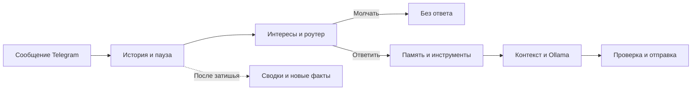

# Byamka

**Byamka — Telegram-бот с настраиваемым характером, памятью и интересами,
работающий через Ollama.**

Он может общаться в личных сообщениях и участвовать в групповой переписке:
учитывать предыдущие реплики, запоминать факты, реагировать на обращения и
выбирать,
стоит ли включаться в разговор без явного вызова.

Стиль общения задаётся системной инструкцией и примерами диалогов.
Память и интересы сохраняются между перезапусками. Модели запускаются на
сервере
Ollama, указанном в конфиге; SQLite и локальный Qdrant хранят данные на диске.

## Что умеет бот

| Возможность                           | Как это работает                                                                                                   |
|---------------------------------------|--------------------------------------------------------------------------------------------------------------------|
| Общение в личных сообщениях и группах | Отвечает на прямые обращения; для остальных сообщений оценивает уместность реакции.                                |
| Продолжение разговора                 | Может распознать следующую реплику того же собеседника без повторного упоминания, пока не истекло окно диалога.    |
| Характер и стиль речи                 | Имя, дополнительные имена, personality и демонстрационные диалоги задаются в YAML.                                 |
| Контекст переписки                    | Передаёт модели историю с отдельными ролями пользователя и бота, авторами и связями reply.                         |
| Сжатие истории                        | Работает по принципу контекстного окна, при исчерпании бюджета происходит сжатии истории.                          |
| Долговременная память                 | Сохраняет факты вручную через команду или автоматически; ищет их по смыслу с помощью embeddings.                   |
| Интересы для каждого чата             | Сочетает воспроизводимые предпочтения по seed с выученными темами, новизной и штрафами за повторы.                 |
| Изображения                           | При совместимой модели анализирует картинки, сохраняет их и создаёт описания для памяти.                           |
| Инструменты                           | Может вызвать калькулятор или дополнительный поиск по памяти перед ответом.                                        |
| Импорт переписки                      | Загружает текстовый Telegram Desktop JSON export, создаёт сводки, факты и темы интересов.                          |
| Обработка серии сообщений             | Ждёт короткую паузу после последней реплики, объединяет ожидающие обычные сообщения, сохраняя их в истории.        |
| Защита от повторов                    | Проверяет подозрительное повторение текста, может перегенерировать ответ и подавить повторный неудачный результат. |

Используется In-Context Learning:
адаптация происходит через контекст, сохранённые факты и оценки интересов.
Голосовые сообщения, расшифровка аудио, видео и веб-поиск сейчас не
реализованы.

## Основной интерес в создании бота

Сейчас большинство llm обучаются как агенты: кодинг, выполнение задач,
следование инструкциям. Стиль общения таких моделей - ассистент.
Я же хотел добиться ощущения полноценного участника чата, со своими интересами
и с хорошим стилем общения.
Один из известных примеров такого бота - это "Сглыпа".

Эта задача делится на две составляющих:

1) Скафолдинг - создание обвязки вокруг модели, для работы в рамках Telegram
   инфраструктуры.
2) Поведение бота. Как заставить модель перестать быть ассистентом и ввести
   себя более живо.

Этап скафолдинга довольно понятен, потребовались некоторые эксперименты и
исправления, но сейчас обвязка работает хорошо.
Такие вещи как контекстное окно, использование инструментов, RAG память
довольно понятны.
Основную проблему, которую пришлось решать - это роутер. В отличии от бота
ассистента, бот не должен отвечать на каждое сообщение.
Поэтому был создан специальный модуль, который анализирует контекст и решат,
стоит ли вступать боту в диалог или нет.

Работа с поведением же была самой сложной. Сначала я использовал модели
семейства Qwen, они ведут себя именно как ассистенты. Очень сухой и
неинтересный стиль общения.
Но я попытался это исправить.

Первая попытка решения - игра с системным промптом: добавление таких
прилагательных, как "смешной", "дружелюбный", "не наивный", не давали
существенного результата.
То есть я пытался задать боту стиль общения и интересы через описание того,
каким он должен быть. Для модели это мало чего дает, результат получается
слабым.

**Вторая попытка** - добавление движка интересов. Он работает примерно так:

1) Получение смысла сообщения. Текст отправляется в embedding-модель. Она
   возвращает числовой вектор, по которому можно сравнивать сообщения по
   смыслу.

2) Расчёт врождённых предпочтений. Вектор проецируется в небольшое
   пространство — по умолчанию из шести измерений. В этой точке вычисляются
   несколько плавных шумовых полей, зависящих от seed. Поэтому близкие
   сообщения обычно вызывают похожую реакцию, а одинаковые настройки дают
   воспроизводимые предпочтения.

3) Поиск знакомых тем. В SQLite находятся похожие темы этого чата. Их
   сохранённые оценки дают выученный интерес. В разных чатах он развивается
   независимо.

4) Оценка новизны и повторяемости. Новая тема получает прибавку. Часто
   встречающаяся становится менее новой. Недавно обсуждавшаяся получает
   дополнительный штраф, который постепенно исчезает за время
   topic_cooldown_minutes.

5) Сохранение наблюдения и обновление темы. Достаточно значимая новая тема
   записывается в базу. Для знакомой темы обновляются её смысловой центр, число
   появлений и выученный интерес.

Итоговая формула рассчитывается так:

```
интерес =
    базовый уровень
  + ограниченный вклад врождённого предпочтения
  + выученный интерес × вес
  + поправка на новизну
  − штраф за недавний повтор
```

Роутер учитывает эти параметры при оценке надобности ответа. Таким образом бот
как бы получает врожденные интересы к некоторым темам.
Но в реализации есть много костылей, а также это не влияет на стиль ответа.
Поэтому можно считать, что это добавление чуть улучшает поведение бота. Это
кандидат на переделку.

На этом этапе бот общался очень слабо, никакой субъектности и осмысленности в
его общении не было. Он вел себя очень глупо, постоянно галлюцинировал,
сообщения были сухими и бессвязными.

В этом поведение прослеживается не только недостаточная настройка, можно
увидеть, что не хватает мощности модели.
Действительно, до этого я пользовался компьютером с 8 ГБ видеопамяти, у модели
был контекст 8 тысяч токенов на все: на системный промпт, на ризонинг, на
инструкции по чтению и обработке сообщений и прочее. Это мало.
Поэтому я переехал на сервер с 22 ГБ видео памяти, далее поднял контекст до 40
тысяч токенов и начал использовать модели от 18 до 30 миллиардов параметров с
квантизацией.

Это радикально улучшило качество ответов. В этот момент я вспомнил о такой
модели Kimi K2. Ее высоко оценивали за живой литературный стиль, а также за
ритм текста.
Поэтому я решил поискать модели с более живым стилем письма, чем Qwen. Были
протестированы 26 моделей, например: модели семейства Qwen с дообучением, Gemma
3 и Gemma 4 обычная и с дообучением. Так же я протестировал GLM 4.7 Flash Uncensored и некоторые другие модели.
Выбор в итоге пал на Gemma 4 26B A4B IT, Unsloth в UD-IQ4_XS. Модель показала очень хороший интеллект, обработку контекста, следование инструкциям. Стиль письма оказался отличным, модель подстраивается под стиль общения, может острить и шутить.
Также плюсом является то, что это MoE модель, из-за этого скорость генерации токенов в 1.5 - 2 раза выше, чем на плотных моделях того же размера.

Далее я добавил модели в системный промпт примеры настоящих диалогов из чата, где имя одного из участников было заменено на имя бота. Это радикально улучшило качества ответа.

## Содержание

- [Как обрабатывается сообщение](#message-flow)
- [Установка и первый запуск](#installation)
- [Команды Telegram](#commands)
- [Настройка: полный справочник](#configuration)
- [Примеры диалогов и стиль](#dialogue-examples)
- [Практические варианты настройки](#recipes)
- [Импорт истории](#history-import)
- [Служебные команды](#cli)
- [Хранение данных и публикация](#storage-and-publication)
- [Диагностика](#troubleshooting)
- [Разработка и структура проекта](#development)

<a id="message-flow"></a>

## Как обрабатывается сообщение

1. Бот сохраняет поступившее сообщение и ждёт настроенную паузу между
   репликами.
2. Движок интересов оценивает тему, а роутер выбирает: ответить, уточнить,
   использовать инструменты или промолчать.
3. Для ответа извлекаются тематические факты и правила поведения. При
   необходимости роутер пересматривает решение после поиска.
4. Планировщик вызывает доступные инструменты, если они нужны.
5. В пределах токенного бюджета собираются personality, примеры, сводки,
   память, история и текущее сообщение.
6. Модель генерирует ответ; приложение очищает reasoning, проверяет повторы,
   ограничивает длину и отправляет сообщение.
7. После затишья фоновая очередь описывает изображения, сжимает историю и
   извлекает новые факты.



Один чат обрабатывается последовательно. Новые входящие сообщения сохраняются,
пока предыдущий ответ генерируется. Уже начатая генерация не отменяется из-за
новой реплики.
Число вызовов модели на сообщение зависит от роутера, памяти, инструментов и
фоновых задач.

<a id="installation"></a>

## Установка и первый запуск

### Требования

- Python 3.11 или 3.12; проверка текущей публичной конфигурации выполнялась на
  Python 3.12.
- Запущенная [Ollama](https://ollama.com/) с доступом к `/api/chat` и
  embeddings API.
- Достаточно оперативной памяти и, при использовании GPU, видеопамяти для
  выбранной модели и контекстного окна.
- Токен Telegram-бота. Создать бота можно
  через [BotFather](https://t.me/BotFather).

Отдельный сервер Qdrant не нужен: используется встроенный локальный режим.
Бот получает сообщения через long polling; публичный HTTP-сервер и webhook для
запуска не требуются.

### 1. Подготовь окружение

Склонируй репозиторий или скачай исходники и перейди в их корневой каталог.
Все следующие команды выполняются из корня проекта.

```sh
python -m venv .venv
```

PowerShell:

```powershell
.\.venv\Scripts\Activate.ps1
```

Linux/macOS:

```sh
source .venv/bin/activate
```

Установи зависимости:

```sh
python -m pip install -r requirements.txt
```

### 2. Создай рабочие настройки

PowerShell:

```powershell
Copy-Item .env.example .env
Copy-Item config/config.example.yaml config/config.yaml
```

Linux/macOS:

```sh
cp .env.example .env
cp config/config.example.yaml config/config.yaml
```

Эти команды предназначены для первой установки; не перезаписывай ими уже
настроенные файлы.
В `.env` заполни переменную `TELEGRAM_BOT_TOKEN` токеном от BotFather.
В `config/config.yaml` задай модели и нужное поведение.
Публичный `config/config.example.yaml` содержит полный набор полей с
комментариями.

### 3. Подготовь модели

Стартовый шаблон использует следующие модели:

```sh
ollama pull deepseek-r1:8b
ollama pull nomic-embed-text
```

Ollama должна работать на адресе `llm.base_url`; в шаблоне это
`http://127.0.0.1:11434`.
Для первой проверки соединения и обеих моделей:

```sh
python -m scripts.check_ollama --config config/config.yaml
```

Скрипт выводит короткий ответ и размер embedding-вектора. Он не подключается к
Telegram.

### 4. Запусти бота

```sh
python -m bot_app.main --config config/config.yaml
```

Напиши боту `/ping`: ответ должен быть `pong`. Для проверки модели отправь
обычный вопрос.
Команды `/start` и `/help` не имеют отдельных обработчиков.

В группе доступность сообщений зависит от Telegram Privacy Mode. Чтобы бот мог
учитывать
обычную переписку, настрой получение таких сообщений через BotFather/права
администратора.
Боты с включённым Privacy Mode получают ограниченный набор сообщений — это не
регулируется
параметрами `routing`.
Подробности: [официальный FAQ Telegram](https://core.telegram.org/bots/faq#what-messages-will-my-bot-get).

<a id="commands"></a>

## Команды Telegram

| Команда                    | Назначение                                                                    |
|----------------------------|-------------------------------------------------------------------------------|
| `/ping`                    | Проверить обработчик Telegram; отвечает `pong`, без генерации LLM.            |
| `/remember текст факта`    | Сохранить факт для текущего чата. Для индексации требуется embedding-модель.  |
| `/memory поисковый запрос` | Найти похожие факты текущего чата и глобальные факты; показать текст и score. |
| `/interests`               | Показать до 8 выученных тем текущего чата.                                    |
| `/fingerprint`             | Получить SVG поля характера; требуется включённый движок интересов.           |

<a id="configuration"></a>

## Настройка: полный справочник

Конфигурация состоит из YAML и переменных окружения. Значения ниже — **значения
публичного
шаблона**, а не чьи-либо рабочие настройки. Если поле пропущено, берётся
значение класса
из [bot_app/config.py](bot_app/config.py). В частности, шаблон явно выключает
vision,
тогда как дефолт класса включает его. Рабочие настройки меняются в
`config/config.yaml`;
после изменения перезапусти процесс бота.

### Как выбираются файлы и пути

- `--config путь` явно выбирает YAML; без него используется
  `config/config.yaml` в корне проекта.
- Переменная окружения процесса `BOT_CONFIG_PATH` заменяет путь по умолчанию
  только для основного бота.
  Её нельзя надёжно задавать лишь в `.env`: разбор CLI происходит до загрузки
  `.env`. Проще использовать `--config`.
- `.env` загружается через `python-dotenv`. Уже заданные переменные окружения
  не перезаписываются.
  Это не файл, автоматически выбираемый рядом с произвольным YAML; для
  стандартного запуска держи `.env` в корне проекта.
- Токен читается из переменной с именем `telegram.token_env`. Все остальные
  настройки в примере задаются YAML.
  Автоматической подстановки `${VARIABLE}` внутри YAML нет.
- Если YAML находится в каталоге с именем `config`, относительные пути
  `data_dir`, `sqlite_path`
  и `qdrant_path` считаются от родителя этого каталога. Иначе — от каталога
  самого YAML.
- `dialogue_examples_file` всегда считается относительно каталога YAML.
- Неизвестное поле внутри секции приводит к ошибке конструктора; неизвестная
  секция верхнего уровня
  сейчас может быть проигнорирована. Проверяй имена: загрузчик не выполняет
  полную строгую проверку типов.

В таблицах `null` означает отсутствие значения, `[]` — пустой список, `true`/
`false` — булевы флаги.
Уверенность и оценки интереса обычно настраиваются в диапазоне 0–1; для лимитов
используй
положительные числа, если рядом явно не описано значение 0.

### Разделы конфига

- [`app` — Приложение и каталоги](#config-app)
- [`telegram` — Подключение Telegram](#config-telegram)
- [`bot` — Имя, стиль и демонстрационные диалоги](#config-bot)
- [`llm` — Модели и генерация](#config-llm)
- [`vision` — Изображения](#config-vision)
- [`routing` — Когда бот отвечает](#config-routing)
- [`context` — Контекст и токенные бюджеты](#config-context)
- [`summarization` — Сжатие текущей истории](#config-summarization)
- [`storage` — SQLite](#config-storage)
- [`vector_db` — Векторная память](#config-vector-db)
- [`personality_engine` — Характер и интересы](#config-personality-engine)
- [`telegram_import` — Импорт истории](#config-telegram-import)
- [`tools` — Инструменты](#config-tools)
- [`auto_memory` — Автоматическое запоминание](#config-auto-memory)

<a id="config-app"></a>

### `app` — Приложение и каталоги

| Параметр    | Тип    | В шаблоне | Назначение и влияние                                                                                                                           |
|-------------|--------|-----------|------------------------------------------------------------------------------------------------------------------------------------------------|
| `name`      | строка | `byamka`  | Название приложения. Информационное поле: сейчас не меняет поведение и не задаёт имя бота в Telegram.                                          |
| `log_level` | строка | `INFO`    | Уровень журналирования: DEBUG, INFO, WARNING или ERROR. INFO показывает этапы обработки и вызовы моделей; DEBUG даёт больше служебных деталей. |
| `data_dir`  | строка | `./data`  | Каталог дополнительных данных: изображений и SVG fingerprint. Пути SQLite и Qdrant задаются отдельно; изменение этого поля их не переносит.    |

<a id="config-telegram"></a>

### `telegram` — Подключение Telegram

| Параметр     | Тип           | В шаблоне            | Назначение и влияние                                                                                                                                                                     |
|--------------|---------------|----------------------|------------------------------------------------------------------------------------------------------------------------------------------------------------------------------------------|
| `token_env`  | строка        | `TELEGRAM_BOT_TOKEN` | Имя переменной окружения с токеном BotFather. Здесь указывается имя переменной, а сам токен хранится в .env или окружении процесса.                                                      |
| `parse_mode` | строка / null | `null`               | Режим форматирования Telegram: null для обычного текста, HTML или MarkdownV2 для разметки. Произвольные ответы модели могут содержать невалидную разметку; null — самый простой вариант. |

<a id="config-bot"></a>

### `bot` — Имя, стиль и демонстрационные диалоги

Текстовая `personality` определяет стиль ответа. `personality_engine` отдельно
рассчитывает
интересы по смыслу сообщений. Изменение одного механизма не заменяет настройку
другого.
`identity_aliases` помогает модели связать имя с собой; техническое прямое
обращение
распознаётся по reply к боту, `@username` или личному чату.

| Параметр                   | Тип             | В шаблоне                                | Назначение и влияние                                                                                                                                          |
|----------------------------|-----------------|------------------------------------------|---------------------------------------------------------------------------------------------------------------------------------------------------------------|
| `display_name`             | строка          | `Бямка`                                  | Имя персонажа в системных инструкциях и контексте. Не переименовывает аккаунт Telegram; при внешнем файле примеров должно совпадать с speaker.                |
| `username`                 | строка / null   | `null`                                   | Username для идентификации бота в контексте. При запуске Telegram-бота автоматически заменяется значением get_me(); обычно оставляется null.                  |
| `identity_aliases`         | список строк    | `[]`                                     | Список дополнительных имён персонажа для системной инструкции. Сам по себе не превращает упоминание имени обычным текстом в прямое обращение роутера.         |
| `personality`              | строка          | `Нейтральная инструкция от первого лица` | Основная инструкция о манере общения: тон, краткость, юмор, язык, приоритеты. Передаётся в системном промпте генерации ответа; удобно писать от первого лица. |
| `dialogue_examples`        | список диалогов | `[]`                                     | Встроенный список вымышленных диалогов для демонстрации стиля. В каждом диалоге чередуются user и assistant; подробнее — в разделе о примерах.                |
| `dialogue_examples_file`   | строка / null   | `null`                                   | Путь к YAML с примерами относительно каталога выбранного конфига. null отключает внешний файл. Не совмещается с непустым dialogue_examples.                   |
| `max_visible_answer_chars` | целое           | `1800`                                   | Максимальная длина видимого ответа в символах. Длинный текст обрезается с многоточием; это ограничение после генерации, а не токенный бюджет модели.          |
| `default_language`         | строка          | `ru`                                     | Поле совместимости, сейчас не используется для выбора языка. Нужный язык задаётся в personality; ряд служебных промптов написан на русском.                   |

<a id="config-llm"></a>

### `llm` — Модели и генерация

Публичный пример использует `deepseek-r1:8b` и `nomic-embed-text`. Это
стартовая
конфигурация, а не обещание одинаковой скорости на любом оборудовании. При
выборе другой
модели проверь её контекстное окно, работу с JSON и поддержку булевого `think`.
Например, некоторые модели требуют строкового уровня reasoning, который этот
клиент
не настраивает.
Подробнее: [thinking в Ollama](https://docs.ollama.com/capabilities/thinking).

Раздельных моделей для роутера, сводок или vision в текущем конфиге нет.
Роутер использует `think=false`, остальные вызовы обычно наследуют
`llm.thinking`.
Из ответа удаляются блоки `<think>`, а отдельное поле reasoning не отправляется
в Telegram.
При исчерпании лимита генерации (`done_reason=length`) клиент возвращает
ошибку,
вместо того чтобы отправлять обрезанный результат.

| Параметр                  | Тип    | В шаблоне                | Назначение и влияние                                                                                                                                                     |
|---------------------------|--------|--------------------------|--------------------------------------------------------------------------------------------------------------------------------------------------------------------------|
| `base_url`                | строка | `http://127.0.0.1:11434` | HTTP-адрес Ollama без /api/chat на конце. Один сервер используется для генерации и embeddings; можно указать локальный сервер или адрес доступного сервера.              |
| `chat_model`              | строка | `deepseek-r1:8b`         | Точное имя установленной в Ollama модели. Одна модель обслуживает ответы, роутер, сводки, извлечение фактов и планирование инструментов; при vision — также изображения. |
| `embedding_model`         | строка | `nomic-embed-text`       | Модель векторных представлений для поиска фактов и интересов. Должна быть установлена отдельно от chat_model; смена модели требует пересоздания совместимых векторов.    |
| `thinking`                | bool   | `true`                   | Передавать think=true в обычных вызовах модели. Роутер и повторная оценка после памяти принудительно используют think=false. Поддержка зависит от выбранной модели.      |
| `num_batch`               | целое  | `1024`                   | Размер пакета обработки входного контекста в Ollama. Увеличение требует больше рабочей памяти GPU; выигрыш скорости зависит от модели и оборудования.                    |
| `keep_alive`              | строка | `3h`                     | Сколько удерживать основную модель в памяти после запроса. Не исключает загрузку после перезапуска сервера или выгрузку из-за нехватки памяти.                           |
| `context_window_tokens`   | целое  | `8192`                   | Размер контекстного окна, передаваемый Ollama как num_ctx. В него должны помещаться инструкции, примеры, история, память, изображения и бюджет генерации.                |
| `reserve_response_tokens` | целое  | `700`                    | Бюджет генерации обычного ответа в токенах. При thinking=true клиент прибавляет reserve_thinking_tokens к общему num_predict; жёсткого разделения внутри Ollama нет.     |
| `reserve_thinking_tokens` | целое  | `1200`                   | Дополнительный бюджет рассуждений в токенах для вызовов с thinking. Он уменьшает место для входного контекста и прибавляется к лимиту генерации.                         |
| `temperature`             | число  | `0.65`                   | Температура обычных ответов. Более низкое значение уменьшает вариативность, более высокое делает ответы разнообразнее; эффект зависит от модели.                         |
| `router_temperature`      | число  | `0.1`                    | Температура решения, отвечать ли на сообщение, и повторного решения после поиска памяти.                                                                                 |
| `summarizer_temperature`  | число  | `0.2`                    | Температура фонового сжатия текущей истории. Для импорта действует отдельная telegram_import.summary_temperature.                                                        |
| `request_timeout_sec`     | целое  | `180`                    | Тайм-аут HTTP-запросов к Ollama в секундах. Увеличивается для медленного оборудования или долгой генерации; это не общий дедлайн всей обработки сообщения.               |

<a id="config-vision"></a>

### `vision` — Изображения

Поддерживаются Telegram-фото и документы с MIME JPEG, PNG, WebP или GIF.
Изображение уменьшается и сохраняется в `data/images`; анимированный GIF не
обрабатывается
как видео. В фоновом режиме модель создаёт текстовое описание для истории.
При прямом reply к старому сообщению с изображением бот может повторно передать
сохранённую картинку модели. Без reply старая картинка представлена описанием,
если оно готово.

Все числовые лимиты этой секции должны быть положительными. Поддержка
нескольких
изображений в запросе не означает, что бот собирает сообщения альбома в один
запрос.

| Параметр                 | Тип   | В шаблоне  | Назначение и влияние                                                                                                                                                      |
|--------------------------|-------|------------|---------------------------------------------------------------------------------------------------------------------------------------------------------------------------|
| `enabled`                | bool  | `false`    | Обработка изображений. В публичном шаблоне выключена, поскольку пример chat_model текстовый. Нужна модель с поддержкой изображений; дефолт класса Config без YAML — true. |
| `max_download_bytes`     | целое | `10485760` | Предел размера загружаемого изображения в байтах. 10485760 = 10 МиБ. Проверяется заявленный размер и фактически загружаемый поток.                                        |
| `max_pixels`             | целое | `25000000` | Максимальное число пикселей исходного изображения до уменьшения: ширина × высота. Слишком большое изображение отклоняется.                                                |
| `max_side`               | целое | `1024`     | Максимальная длина стороны сохранённого изображения в пикселях. Пропорции сохраняются; большие изображения уменьшаются.                                                   |
| `max_images_per_request` | целое | `1`        | Максимальное число изображений в одном запросе ответа к модели. Не добавляет отдельную сборку Telegram-альбомов.                                                          |
| `reserve_image_tokens`   | целое | `4096`     | Оценочный резерв токенов на одно изображение при упаковке промпта. Это бюджет приложения, а не точный размер изображения в токенах выбранной модели.                      |
| `description_tokens`     | целое | `512`      | Бюджет текстового описания изображения для памяти. При включённом thinking клиент дополнительно добавляет бюджет рассуждений.                                             |

<a id="config-routing"></a>

### `routing` — Когда бот отвечает

В личном чате каждое сообщение считается обращением к боту. В группе прямыми
обращениями считаются reply к его сообщению и текстовое упоминание `@username`.
Обычная реплика проходит проверку уместности моделью, ограничения частоты и
пороги интереса.
Это реакция на входящее сообщение: таймера самостоятельной отправки сообщений
здесь нет.

При ошибке роутера бот пытается ответить на прямое обращение или уже
распознанное
продолжение диалога; для обычной реплики выбирает молчание. Даже прямое
обращение
не гарантирует доставку: генерация, проверка повторов или отправка могут
завершиться ошибкой.

| Параметр                            | Тип   | В шаблоне | Назначение и влияние                                                                                                                                                          |
|-------------------------------------|-------|-----------|-------------------------------------------------------------------------------------------------------------------------------------------------------------------------------|
| `message_debounce_seconds`          | число | `1.0`     | Пауза после последнего сообщения в чате перед обработкой. Новая реплика продлевает ожидание; 0 отключает паузу. Уже начатый ответ не отменяется.                              |
| `answer_on_direct_reply`            | bool  | `true`    | Поле совместимости: сейчас роутер не читает этот флаг. Установка false не отключает ответы на reply к боту.                                                                   |
| `answer_on_mention`                 | bool  | `true`    | Поле совместимости: сейчас роутер не читает этот флаг. Установка false не отключает ответы на @username или личные сообщения.                                                 |
| `allow_spontaneous_replies`         | bool  | `true`    | Разрешить реакции без явного обращения. false также отключает автоматическое распознавание продолжения диалога без reply/@username; прямые обращения сохраняются.             |
| `spontaneous_reply_min_confidence`  | число | `0.72`    | Базовый порог уверенности роутера для спонтанного ответа, обычно от 0 до 1. Более высокий порог уменьшает число таких ответов; интересы могут его снизить.                    |
| `direct_reply_min_confidence`       | число | `0.2`     | Базовый порог для прямого обращения. В текущей реализации прямые обращения обходят отсев по низкой уверенности, поэтому это не способ заставить бота игнорировать упоминания. |
| `chat_cooldown_seconds`             | целое | `12`      | Минимальный интервал после последнего ответа для нового спонтанного ответа, в секундах. Прямое обращение и распознанное продолжение диалога обходят этот фильтр.              |
| `max_bot_replies_in_recent_window`  | целое | `3`       | Лимит ответов бота среди недавних сообщений для спонтанных реакций. Прямые обращения и продолжение диалога обходят ограничение.                                               |
| `recent_window_messages`            | целое | `12`      | Число последних сообщений, отбираемых для роутера и проверки активности бота. Дополнительно действует context.router_history_tokens.                                          |
| `followup_window_seconds`           | целое | `180`     | Окно продолжения разговора после ответа бота, в секундах. Проверяется тот же собеседник и отсутствие переключения на другого участника.                                       |
| `dialogue_reply_min_confidence`     | число | `0.5`     | Порог уверенности для распознанного продолжения разговора без прямого обращения. Ниже порог — легче продолжить беседу.                                                        |
| `post_memory_review_enabled`        | bool  | `true`    | Повторно оценивать уместность ответа после поиска фактов. Вызов пропускается при пустой памяти и для уже распознанного продолжения диалога.                                   |
| `allow_post_memory_ignore_direct`   | bool  | `false`   | Разрешить второму проходу отменить ответ на прямое обращение. false сохраняет решение отвечать на прямые обращения.                                                           |
| `post_memory_ignore_min_confidence` | число | `0.65`    | Минимальная уверенность повторного роутера, необходимая для отмены ответа после поиска памяти.                                                                                |
| `post_memory_review_num_predict`    | целое | `512`     | Лимит токенов JSON-решения второго роутера. Этот вызов работает без thinking, независимо от llm.thinking.                                                                     |

<a id="config-context"></a>

### `context` — Контекст и токенные бюджеты

Токены оцениваются приближённо, примерно по 3.2 символа на токен, без
токенизатора
конкретной модели. `history_max_tokens` — потолок, а не гарантированный объём.
Например, при окне 8192 токена в него не поместятся 14000 токенов истории:
приложение уменьшит фактический бюджет с учётом остальных частей запроса.

Должно выполняться `0 < history_keep_ratio < history_compact_ratio < 1`.
Поля `history_max_tokens`, `router_history_tokens` и `prompt_safety_tokens`
должны быть положительными. Увеличение числа примеров, длины personality,
резерва thinking или изображений сокращает доступную историю.

| Параметр                            | Тип   | В шаблоне | Назначение и влияние                                                                                                                                             |
|-------------------------------------|-------|-----------|------------------------------------------------------------------------------------------------------------------------------------------------------------------|
| `history_max_tokens`                | целое | `14000`   | Верхняя граница токенного бюджета несжатой истории. Фактический бюджет ограничен llm.context_window_tokens за вычетом остальных резервов.                        |
| `history_compact_ratio`             | число | `0.9`     | Доля доступного бюджета истории, при достижении которой запускается фоновое сжатие старого фрагмента. 0.9 означает 90%.                                          |
| `history_keep_ratio`                | число | `0.5`     | Целевая доля бюджета, оставляемая свежей несжатой истории после сжатия. 0.5 означает 50%; самый новый элемент сохраняется.                                       |
| `router_history_tokens`             | целое | `2500`    | Максимальный токенный бюджет последних сообщений для роутера. Не определяет размер истории, доступной генератору ответа.                                         |
| `prompt_safety_tokens`              | целое | `1024`    | Запас токенов на служебную упаковку и неточность оценки. Увеличение уменьшает доступный объём истории.                                                           |
| `examples_max_tokens`               | целое | `1200`    | Верхний бюджет демонстрационных диалогов. Диалоги включаются целиком; слишком длинные пропускаются, а фактический бюджет может быть меньше.                      |
| `recent_messages_limit`             | целое | `40`      | Резервный лимит сообщений для отдельного чтения ChatStateBuilder. В основном конвейере передаётся уже отобранная история, поэтому это не лимит контекста ответа. |
| `recent_messages_soft_limit_tokens` | целое | `2500`    | Резерв места для свежей истории при выборе объёма примеров. Не является жёстким ограничением всей истории ответа.                                                |
| `summaries_limit`                   | целое | `6`       | Максимальное число последних сводок, запрашиваемых для промпта. Итоговый объём также ограничивается общим бюджетом.                                              |
| `facts_limit`                       | целое | `5`       | Максимум обычных тематических фактов для поиска и добавления в ответ. Поведенческие правила ищутся отдельно с лимитом 4 в коде.                                  |
| `tool_results_limit`                | целое | `4`       | Максимум результатов инструментов, рассматриваемых при сборке контекста ответа. Не увеличивает tools.max_tool_calls.                                             |
| `current_message_extra_tokens`      | целое | `400`     | Дополнительный резерв для текущего сообщения при распределении места между примерами и историей. Не является лимитом длины входного сообщения.                   |
| `facts_min_score`                   | число | `0.55`    | Минимальное сходство найденного тематического факта с запросом. Чем выше порог, тем меньше нерелевантной памяти попадёт в ответ.                                 |
| `behavior_facts_min_score`          | число | `0.55`    | Минимальное сходство для найденных правил поведения и предпочтений собеседников. Это отдельный фильтр от facts_min_score.                                        |

<a id="config-summarization"></a>

### `summarization` — Сжатие текущей истории

Сжатие запускается по заполнению токенного окна из `context.history_*`.
Старый фрагмент получает сводку и помечается как обработанный; исходные
сообщения
из SQLite не удаляются. При большом накопленном объёме на один проход может
поместиться лишь часть старого фрагмента.
Для импортированной истории используются отдельные параметры `telegram_import`.

| Параметр                    | Тип   | В шаблоне | Назначение и влияние                                                                                                                      |
|-----------------------------|-------|-----------|-------------------------------------------------------------------------------------------------------------------------------------------|
| `enabled`                   | bool  | `true`    | Фоновое сжатие текущей истории в сводки. При false старая история остаётся на диске, но может перестать помещаться в запросы модели.      |
| `keep_recent_messages`      | целое | `35`      | Устаревшее поле, сейчас не используется. Остаток истории определяется context.history_keep_ratio и токенным бюджетом.                     |
| `min_unsummarized_messages` | целое | `25`      | Устаревшее поле, сейчас не используется. Триггер сжатия определяется context.history_compact_ratio, а не числом сообщений.                |
| `chunk_size`                | целое | `30`      | Устаревшее поле, сейчас не используется. Размер сжимаемого фрагмента выбирается по доступному токенному бюджету.                          |
| `max_summary_tokens`        | целое | `600`     | Лимит генерации одной фоновой сводки. Более длинная сводка может сохранить больше деталей, но занимает больше места в следующих запросах. |

<a id="config-storage"></a>

### `storage` — SQLite

| Параметр      | Тип    | В шаблоне            | Назначение и влияние                                                                                                                                                    |
|---------------|--------|----------------------|-------------------------------------------------------------------------------------------------------------------------------------------------------------------------|
| `sqlite_path` | строка | `./data/bot.sqlite3` | Путь к SQLite. Здесь хранятся сообщения, сводки, факты, интересы, метаданные изображений и события инструментов. Новый путь открывает другую базу, не переносит старую. |

<a id="config-vector-db"></a>

### `vector_db` — Векторная память

SQLite хранит записи и текстовые факты, Qdrant — их векторы для поиска по
смыслу.
Бот инициализирует векторную память при запуске, поэтому embedding-модель нужна
даже при выключенных `auto_memory` и `personality_engine`.
Изменение модели embeddings не мигрирует коллекцию и сохранённые в SQLite
векторы тем:
для эксперимента используй отдельные пути SQLite/Qdrant и повторный импорт.

| Параметр       | Тип    | В шаблоне       | Назначение и влияние                                                                                                                                               |
|----------------|--------|-----------------|--------------------------------------------------------------------------------------------------------------------------------------------------------------------|
| `provider`     | строка | `qdrant_local`  | Информационное поле совместимости. Реализован локальный Qdrant; изменение строки не подключает другой backend или удалённый сервер.                                |
| `qdrant_path`  | строка | `./data/qdrant` | Каталог локального Qdrant. Отдельный сервер Qdrant не нужен. Не запускай одновременно два процесса с одним каталогом локального хранилища.                         |
| `collection`   | строка | `bot_facts`     | Имя коллекции embeddings фактов. Для другой embedding-модели используй новую коллекцию и заново индексируй факты; старые векторы автоматически не пересчитываются. |
| `search_limit` | целое  | `5`             | Лимит результатов поиска по умолчанию, в том числе для /memory и инструмента поиска. Для контекста ответа отдельно применяется context.facts_limit.                |

<a id="config-personality-engine"></a>

### `personality_engine` — Характер и интересы

Embeddings сообщений проецируются в небольшое пространство. Поле
Perlin-подобного
шума с фиксированным seed задаёт устойчивые оценки интереса, любопытства,
юмора,
памяти и желания ответить. Поверх них учитываются темы конкретного чата,
новизна и повторяемость. Обучаются записи тем в SQLite; веса самой LLM не
меняются.

Итоговый интерес ограничивается диапазоном 0–1 и рассчитывается примерно так:

```text
base_interest
+ min(max_innate_contribution, innate_weight × innate_interest)
+ learned_weight × learned_interest
+ novelty_weight × (novelty − 0.5)
− repetition_penalty
```

Оси `reply` и `memory` — отдельные оценки, а не синонимы итогового интереса.
Поэтому изменение `base_interest` не равнозначно изменению порога ответов.
Fingerprint — детерминированная картинка поля характера, а не график выученных
тем;
текущие темы можно посмотреть командой `/interests`.

| Параметр                          | Тип   | В шаблоне | Назначение и влияние                                                                                                                                             |
|-----------------------------------|-------|-----------|------------------------------------------------------------------------------------------------------------------------------------------------------------------|
| `enabled`                         | bool  | `true`    | Включить семантический движок интересов и обучение темам чата. При false текстовая personality продолжает работать, но профиль интересов в ответ не добавляется. |
| `seed`                            | целое | `73421`   | Число, определяющее воспроизводимую проекцию и врождённые предпочтения. Смена seed меняет их и fingerprint, но не удаляет уже выученные темы из SQLite.          |
| `latent_dim`                      | целое | `6`       | Размерность пространства, в которое проецируются embeddings. Минимум в реализации — 2; увеличение резко повышает стоимость многомерного Perlin-поля.             |
| `noise_scale`                     | число | `2.7`     | Масштаб координат поля интересов. Большее значение даёт более частые изменения предпочтений между близкими точками.                                              |
| `octaves`                         | целое | `4`       | Количество слоёв фрактального шума, минимум 1. Больше слоёв — более подробное поле и больше вычислений.                                                          |
| `persistence`                     | число | `0.55`    | Множитель амплитуды каждого следующего слоя шума. Определяет вклад мелких деталей поля относительно крупных.                                                     |
| `base_interest`                   | число | `0.35`    | Базовая составляющая итогового интереса к теме до учёта врождённого и выученного интереса, новизны и повторов.                                                   |
| `innate_weight`                   | число | `0.2`     | Вес врождённого интереса в итоговом интересе. Его вклад сверху ограничивает max_innate_contribution.                                                             |
| `learned_weight`                  | число | `0.35`    | Вес интереса к темам, выученным в текущем чате, в итоговой оценке.                                                                                               |
| `novelty_weight`                  | число | `0.28`    | Вес новизны относительно нейтрального значения 0.5. Новая тема может повышать итоговый интерес, знакомая — понижать.                                             |
| `max_innate_contribution`         | число | `0.12`    | Верхняя граница вклада врождённого интереса. Не позволяет одному seed полностью определять итоговую оценку темы.                                                 |
| `learned_similarity_threshold`    | число | `0.72`    | Минимальное сходство сообщения с сохранённой темой для учёта выученного интереса.                                                                                |
| `learned_topics_limit`            | целое | `5`       | Максимальное число похожих сохранённых тем, участвующих в оценке одного сообщения. Не ограничивает общее число тем в базе.                                       |
| `topic_merge_similarity`          | число | `0.86`    | Порог сходства для обновления существующей темы вместо создания новой. Ниже порог — более широкое объединение тем.                                               |
| `learn_rate`                      | число | `0.08`    | Скорость роста выученного интереса при положительном сигнале во время обновления темы.                                                                           |
| `learn_decay`                     | число | `0.015`   | Доля затухания старого интереса при обновлении темы. Это не ежедневное или часовое фоновое затухание.                                                            |
| `learn_negative_rate`             | число | `0.04`    | Сила уменьшения интереса при слабом сигнале относительно save_interest_threshold.                                                                                |
| `learn_repetition_decay`          | число | `0.1`     | Дополнительное уменьшение выученного интереса за повторяемость темы.                                                                                             |
| `min_learned_interest`            | число | `0.02`    | Нижняя граница оценки выученного интереса при создании и обновлении темы.                                                                                        |
| `topic_cooldown_minutes`          | целое | `180`     | Окно штрафа за недавно встречавшуюся похожую тему, в минутах. Штраф постепенно уменьшается; 0 отключает этот временной штраф.                                    |
| `repeated_topic_penalty`          | число | `0.35`    | Максимальный масштаб штрафа за недавний повтор. Фактическое значение зависит от сходства и времени с прошлого появления темы.                                    |
| `novelty_seen_count_strength`     | число | `0.08`    | Сила уменьшения новизны по числу встреч с темой. Используется с log(1 + seen_count).                                                                             |
| `max_novelty_penalty`             | число | `0.45`    | Верхняя граница штрафа новизны за многократные встречи с темой.                                                                                                  |
| `repetition_bias_block_threshold` | число | `0.18`    | При таком штрафе повторяемости роутер перестаёт смягчать пороги из-за интереса. Само сообщение этот параметр не блокирует.                                       |
| `boost_reply_threshold`           | число | `0.66`    | Порог оси reply профиля, после которого базовый порог спонтанного ответа может снижаться. Это не порог итогового final_interest.                                 |
| `spontaneous_reply_threshold`     | число | `0.84`    | Порог оси reply для усиления уверенности уже разрешённой спонтанной реакции. Не отменяет ignore и ограничения частоты.                                           |
| `memory_interest_threshold`       | число | `0.76`    | Порог оси memory для интереса к запоминанию, сохранения тем и усиления обращения к памяти.                                                                       |
| `save_interest_threshold`         | число | `0.72`    | Порог итогового интереса для сохранения/обновления темы и расчёта положительного сигнала обучения. Высокая ось memory также может разрешить сохранение.          |
| `router_threshold_discount`       | число | `0.12`    | На сколько снизить базовый порог спонтанного ответа при достаточно высокой оси reply и отсутствии сильного штрафа повторов; итог не ниже 0.05.                   |
| `fingerprint_size`                | целое | `96`      | Количество ячеек по каждой стороне SVG fingerprint, минимум в рендерере — 24. Работа растёт примерно с квадратом размера.                                        |
| `fingerprint_cell_px`             | целое | `5`       | Размер одной ячейки SVG в пикселях, минимум 2. Например, 96 × 5 даёт поле 480 × 480 пикселей плюс подпись.                                                       |

<a id="config-telegram-import"></a>

### `telegram_import` — Импорт истории

Импорт запускается отдельно и не включается автоматически при старте бота.
Четыре переключателя этапов ниже являются дефолтами Python-метода импортёра.
Текущий CLI всегда передаёт собственные значения из флагов `--no-*`, поэтому
при запуске скрипта именно эти флаги управляют отключением этапов.
`telegram_import.enabled` пока не проверяется реализацией.

| Параметр                            | Тип    | В шаблоне            | Назначение и влияние                                                                                                                                           |
|-------------------------------------|--------|----------------------|----------------------------------------------------------------------------------------------------------------------------------------------------------------|
| `enabled`                           | bool   | `true`               | Поле совместимости: текущий импортёр и CLI не проверяют его. false не блокирует импорт; он запускается только явным вызовом скрипта.                           |
| `import_messages`                   | bool   | `true`               | Сохранять исходные сообщения при вызове импортёра из Python без явного переопределения. В CLI это управляется флагом --no-messages.                            |
| `build_summaries`                   | bool   | `true`               | Создавать сводки импортированных сообщений при вызове импортёра из Python. В CLI используется --no-summaries; сводкам нужны записи сообщений в SQLite.         |
| `extract_facts`                     | bool   | `true`               | Извлекать факты, правила и темы при вызове импортёра из Python. В CLI используется --no-facts.                                                                 |
| `update_interests`                  | bool   | `true`               | Обновлять темы интересов по импортированным сообщениям при вызове импортёра из Python. В CLI используется --no-interests; нужен включённый personality_engine. |
| `message_id_mode`                   | строка | `negative_export_id` | negative_export_id сохраняет экспортные ID как отрицательные для отделения от новых Telegram-сообщений. preserve оставляет исходные ID.                        |
| `skip_service_messages`             | bool   | `true`               | Пропускать сервисные события экспорта, например изменения состава группы.                                                                                      |
| `skip_empty_text`                   | bool   | `true`               | Пропускать записи без текста. Импортёр работает с текстовой историей и не переносит изображения в vision-память.                                               |
| `min_text_chars_for_facts`          | целое  | `10`                 | Минимальная длина текста сообщения в символах для включения в извлечение фактов.                                                                               |
| `min_text_chars_for_interests`      | целое  | `4`                  | Минимальная длина текста в символах для повторного проигрывания через движок интересов.                                                                        |
| `summary_chunk_size`                | целое  | `80`                 | Число сообщений в одном фрагменте для импортной сводки. Уменьшай при длинных сообщениях или небольшом контекстном окне.                                        |
| `summary_max_tokens`                | целое  | `900`                | Лимит генерации одной импортной сводки. При thinking клиент добавляет общий резерв рассуждений.                                                                |
| `summary_temperature`               | число  | `0.15`               | Температура сводок при импорте. Не зависит от llm.summarizer_temperature для текущей переписки.                                                                |
| `mark_imported_messages_summarized` | bool   | `true`               | Помечать сообщения успешно обработанного фрагмента как сжатые после сохранения его сводки.                                                                     |
| `fact_chunk_size`                   | целое  | `60`                 | Число подходящих сообщений в одном запросе извлечения импортных фактов.                                                                                        |
| `max_facts_per_chunk`               | целое  | `12`                 | Максимальное число фактов из одного импортного фрагмента.                                                                                                      |
| `fact_min_confidence`               | число  | `0.76`               | Минимальная оценка уверенности модели для сохранения импортного факта.                                                                                         |
| `fact_duplicate_score_threshold`    | число  | `0.91`               | Порог сходства с уже сохранённым фактом, начиная с которого новый импортный факт считается дубликатом.                                                         |
| `fact_temperature`                  | число  | `0.0`                | Температура извлечения фактов из экспортированной истории.                                                                                                     |
| `fact_num_predict`                  | целое  | `1100`               | Бюджет JSON с фактами из одного фрагмента. Увеличивай вместе с max_facts_per_chunk; при thinking добавляется резерв рассуждений.                               |
| `interest_max_messages`             | целое  | `0`                  | Максимум последних подходящих сообщений для обновления интересов. 0 означает все подходящие сообщения.                                                         |
| `progress_every_messages`           | целое  | `100`                | Период вывода прогресса обработки сообщений в консоль, в сообщениях.                                                                                           |
| `progress_every_chunks`             | целое  | `5`                  | Период вывода прогресса обработки сводок и фактов, в фрагментах.                                                                                               |

<a id="config-tools"></a>

### `tools` — Инструменты

Стандартный набор содержит арифметический калькулятор и поиск фактов.
Планировщик вызывается только если роутер запросил инструменты. Это один план
с ограниченным числом вызовов, а не неограниченный агентный цикл.
Собственные инструменты добавляются в [реестр](bot_app/tools/registry.py).

| Параметр                  | Тип   | В шаблоне | Назначение и влияние                                                                                                                                                  |
|---------------------------|-------|-----------|-----------------------------------------------------------------------------------------------------------------------------------------------------------------------|
| `enabled`                 | bool  | `true`    | Общий переключатель вызова инструментов через LLM-планировщик. Не отключает Telegram-команды /memory и /remember или обычное извлечение памяти.                       |
| `planner_enabled`         | bool  | `true`    | Разрешить модели составлять план вызовов инструментов, когда роутер считает их нужными.                                                                               |
| `allow_side_effect_tools` | bool  | `false`   | Разрешить зарегистрированные инструменты с пометкой side_effect. В стандартном наборе только калькулятор и поиск памяти; флаг не добавляет shell или доступ к файлам. |
| `max_tool_calls`          | целое | `3`       | Максимальное число вызовов из одного плана перед генерацией ответа.                                                                                                   |
| `calculator_enabled`      | bool  | `true`    | Зарегистрировать калькулятор арифметических выражений на основе AST.                                                                                                  |
| `memory_search_enabled`   | bool  | `true`    | Зарегистрировать инструмент семантического поиска по памяти текущего чата и глобальным фактам.                                                                        |

<a id="config-auto-memory"></a>

### `auto_memory` — Автоматическое запоминание

Извлечение фактов идёт в фоне после периода затишья. Запомненный факт может
появиться позже ответа бота. `min_confidence` — самооценка модели, а пороги
сходства —
оценки векторного поиска: они не гарантируют истинность факта.
Глобальные факты доступны нескольким чатам; по умолчанию автоматическое
сохранение
ограничено текущим `chat_id`.

| Параметр                              | Тип   | В шаблоне | Назначение и влияние                                                                                                                                                                   |
|---------------------------------------|-------|-----------|----------------------------------------------------------------------------------------------------------------------------------------------------------------------------------------|
| `enabled`                             | bool  | `true`    | Автоматически извлекать устойчивые факты из новых сообщений в фоне. Не отключает хранение самих сообщений, /remember и поиск существующих фактов.                                      |
| `ignore_commands`                     | bool  | `true`    | Не анализировать сообщения, начинающиеся с /. Полезно, чтобы не извлекать факты из команд повторно.                                                                                    |
| `min_text_chars`                      | целое | `12`      | Минимальная длина входного сообщения в символах для обращения к модели-экстрактору.                                                                                                    |
| `min_fact_chars`                      | целое | `20`      | Минимальная длина текста извлечённого факта в символах для сохранения.                                                                                                                 |
| `max_facts_per_message`               | целое | `3`       | Максимальное число кандидатов в факты, рассматриваемых из одного сообщения.                                                                                                            |
| `min_confidence`                      | число | `0.72`    | Минимальная уверенность модели для сохранения факта. Более высокий порог делает память избирательнее.                                                                                  |
| `duplicate_score_threshold`           | число | `0.92`    | Порог сходства с существующим фактом, начиная с которого новый факт не сохраняется повторно.                                                                                           |
| `temperature`                         | число | `0.0`     | Температура автоматического извлечения фактов из текущей переписки.                                                                                                                    |
| `num_predict`                         | целое | `700`     | Лимит генерации JSON с фактами одного сообщения; при thinking добавляется llm.reserve_thinking_tokens.                                                                                 |
| `allow_global_facts`                  | bool  | `false`   | Разрешить фактам с scope=global сохраняться без chat_id и быть доступными в других чатах. false сохраняет автоматически извлечённые факты в текущем чате.                              |
| `interest_memory_confidence_discount` | число | `0.08`    | Снижение min_confidence при высокой оси memory, если экстрактору передан профиль интересов. Основной фоновый обработчик сейчас профиль не передаёт, поэтому там скидка не применяется. |

<a id="dialogue-examples"></a>

## Примеры диалогов и стиль

`personality` описывает правила словами, а `dialogue_examples` показывает
желаемую манеру
на конкретных репликах. Примеры добавляются к запросу модели перед текущей
перепиской.
Они не сохраняются как реальные сообщения чата и не обучают веса модели.

Пример встроенных вымышленных диалогов — фрагмент секции `bot`:

```yaml
bot:
  display_name: "Бямка"
  personality: >
    Я Бямка, участник Telegram-чата. Отвечаю кратко и понятно.
    Если данных недостаточно, задаю уточняющий вопрос.
  dialogue_examples:
    - - role: user
        content: "Что получится, если сложить 2 и 2?"
      - role: assistant
        content: "4."
    - - role: user
        content: "Поможешь разобраться с задачей?"
      - role: assistant
        content: "Да. Пришли условие и покажи, где возник вопрос."
  dialogue_examples_file: null
```

Для большого набора удобнее отдельный **локальный** файл
`config/dialogue_examples.yaml`.
Создай его из публичного шаблона `config/dialogue_examples.example.yaml` с
вымышленным диалогом:

```powershell
Copy-Item config/dialogue_examples.example.yaml config/dialogue_examples.yaml
```

В Linux/macOS используй `cp` вместо `Copy-Item`. Утилита добавления примеров
ожидает, что целевой файл уже существует. После добавления он может выглядеть
так:

```yaml
speaker: "Бямка"
dialogues:
  - - role: user
      content: "Привет!"
    - role: assistant
      content: "Привет. Как дела?"
```

В рабочей секции `bot` укажи:

```yaml
bot:
  display_name: "Бямка"
  dialogue_examples: [ ]
  dialogue_examples_file: "dialogue_examples.yaml"
```

Правила формата:

- Внешний `speaker` должен в точности совпадать с `bot.display_name`.
- Каждый диалог содержит хотя бы одну полную пару `user`/`assistant`; роли
  строго чередуются.
- Текст каждой реплики — непустая строка; диалог заканчивается ответом
  `assistant`.
- Один диалог может содержать несколько пар. Разные элементы списка —
  независимые разговоры.
- Нельзя одновременно задать внешний файл и непустой встроенный список.
- Примеры включаются целыми диалогами в пределах `context.examples_max_tokens`
  и оставшегося места.

Добавить короткий пример, не редактируя YAML вручную:

```powershell
python scripts/add_dialogue_example.py --user "Как прошёл день?" --assistant "Я опять спорил с холодильником. Пока ничья."
```

Для продолжения того же разговора повтори `--user` и `--assistant` в нужном
порядке. Один запуск создаёт один независимый диалог. Если важны авторы
нескольких участников или нужны сразу несколько диалогов, подготовь отдельный
JSON/YAML с полями `dialogue` (один диалог) или `dialogues` (список диалогов):

```yaml
dialogue:
  - role: user
    content: '{"messages": [{"author": "Участник", "text": "Он ещё и острит"}]}'
  - role: assistant
    content: "А ты думал, я тут только электричество жру"
```

```powershell
python scripts/add_dialogue_example.py --input новый_пример.yaml --dry-run
python scripts/add_dialogue_example.py --input новый_пример.yaml
```

Можно подать и скопированный фрагмент Telegram, где строки начинаются с даты,
времени и имени, а ответы имеют вид `Имя in reply to Другое имя:`. Укажи *
*точное имя участника**, чьи сообщения следует заменить на реплики Бямки:

```powershell
python scripts/add_dialogue_example.py --telegram-text переписка.txt --replace-speaker "Имя участника" --dry-run
python scripts/add_dialogue_example.py --telegram-text переписка.txt --replace-speaker "Имя участника"
```

Сообщения остальных участников сохраняются с именами в контексте `user`; подряд
идущие реплики одного типа объединяются. Цитаты после `>` сохраняются как
`quoted_text`. Если фрагмент начинается с выбранного участника, утилита
добавляет перед его ответом нейтральную пометку о начале независимого примера.
Если после последнего ответа выбранного участника остаются сообщения без
ответа, они пропускаются с предупреждением. Перед записью проверь `--dry-run`:
он покажет получившийся пример.

Команда добавляет примеры в начало списка `config/dialogue_examples.yaml`,
чтобы они не выпадали из бюджета примеров после старых диалогов. Она проверяет
чередование ролей и пропускает точные дубликаты. Перед записью создаётся файл
`.bak` с исходным содержимым; комментарии и старые диалоги сохраняются. Для
другого файла передай `--examples путь/к/файлу.yaml`. После добавления
перезапусти бота, чтобы он перечитал примеры.

Публичный шаблон примеров содержит вымышленные разговоры с одним и несколькими
участниками; замени их,
если хочешь задать другой стиль. Для собственных примеров используй вымышленные
реплики или материалы, которые можно использовать и хранить. Локальные файлы в
`config/`,
кроме публичного шаблона, исключены из Git.

<a id="recipes"></a>

## Практические варианты настройки

Ниже — **изменения отдельных полей**, которые нужно внести в соответствующие
существующие
секции `config/config.yaml`. Не добавляй второй ключ `llm`, `routing` и т. п. в
том же YAML.

### Отвечать только при явном обращении

```yaml
routing:
  allow_spontaneous_replies: false
```

В личном чате сообщения по-прежнему считаются прямыми. В группе нужны reply к
боту
или `@username`. Автоматическое продолжение без упоминания тоже отключится.
Флаги `answer_on_mention` и `answer_on_direct_reply` для этой цели не работают.

### Реже вступать в групповую беседу

```yaml
routing:
  spontaneous_reply_min_confidence: 0.85
  chat_cooldown_seconds: 30
  max_bot_replies_in_recent_window: 2
personality_engine:
  router_threshold_discount: 0.05
```

Это ограничивает обычные спонтанные реакции. Прямые обращения и уже
распознанное
продолжение диалога используют другую логику. Порог — оценка модели, а не
вероятность ответа.

### Больше истории и места для reasoning

```yaml
llm:
  context_window_tokens: 32768
  reserve_response_tokens: 2048
  reserve_thinking_tokens: 4096
context:
  history_max_tokens: 14000
  examples_max_tokens: 2400
```

Используй такой профиль только если модель и оборудование выдерживают выбранное
окно.
Для thinking-вызова обычного ответа общий `num_predict` в этом примере равен
6144,
а не 2048. Увеличение окна и генерации может повысить расход памяти и задержку.

### Снизить число дополнительных вызовов модели

```yaml
routing:
  post_memory_review_enabled: false
tools:
  planner_enabled: false
auto_memory:
  enabled: false
personality_engine:
  enabled: false
```

Останутся генерация ответа, основной роутер, работа с существующей памятью и
сводки.
Это не режим «один запрос на сообщение». `summarization.enabled: false`
отключает
сводки, но тогда старые сообщения будут выпадать из доступного контекста без
сжатого пересказа.

### Подключить изображения

Выбери установленную модель с поддержкой изображений в `llm.chat_model`, затем
установи
`vision.enabled: true`. Отдельного `vision_model` нет. Заложи в окно модели
`reserve_image_tokens` на каждую картинку помимо текста, ответа и reasoning.
Одна лишь установка `vision.enabled` не добавляет vision-возможности текстовой
модели.

<a id="history-import"></a>

## Импорт истории Telegram

Импортёр принимает JSON из Telegram Desktop: отдельный чат или полный экспорт с
`chats.list`.
Он может сохранить текст сообщений, построить сводки, извлечь факты и проиграть
историю
через движок интересов. Это наполнение памяти приложения, а не fine-tuning LLM.

1. Экспортируй переписку в JSON и положи её, например, в
   `data/telegram_export/result.json`.
2. Укажи `target_chat_id` чата, которому должна принадлежать импортированная
   память.
3. Останови запущенный бот перед импортом в тот же каталог локального Qdrant.
4. Сначала проверь выбор чата и статистику.

В примерах `123456789` — вымышленный ID; замени его на целевой ID Telegram.

```sh
python -m scripts.import_telegram_export --json data/telegram_export/result.json --target-chat-id 123456789 --config config/config.yaml --dry-run --no-summaries --no-facts --no-interests
```

`--dry-run` не импортирует сообщения, факты и интересы и не вызывает модели для
этих этапов.
Однако CLI загружает конфиг, создаёт каталоги и подключает/инициализирует
SQLite;
это не гарантия полного отсутствия файловых изменений. Для полностью отдельной
проверки
укажи тестовые пути хранения в отдельном конфиге.

Сам импорт:

```sh
python -m scripts.import_telegram_export --json data/telegram_export/result.json --target-chat-id 123456789 --config config/config.yaml
```

Если экспорт содержит несколько чатов, добавь `--source-chat-id` или
`--source-chat-name "Название чата"`. Первый выбирает исходный чат в экспорте,
а `--target-chat-id` определяет, в какой чат памяти приложения попадут данные.

| Флаг             | Что отключает                                                                      |
|------------------|------------------------------------------------------------------------------------|
| `--no-messages`  | Сохранение исходных сообщений; без записей сообщений импортные сводки не строятся. |
| `--no-summaries` | Создание сводок.                                                                   |
| `--no-facts`     | Извлечение и индексацию фактов.                                                    |
| `--no-interests` | Обновление тем интересов по истории.                                               |

Флаги CLI переопределяют четыре одноимённых по смыслу переключателя этапов в
YAML.
Экспортные ID по умолчанию становятся отрицательными. Это отделяет их от новых
событий,
но не делает ID разных экспортов уникальными: при объединении разных исходных
чатов
в один `target_chat_id` возможны совпадения.

Скрипт выводит статистику, найденные темы и примеры фактов. Такой вывод может
содержать
личную информацию. Дополнительное
описание: [импорт Telegram](docs/TELEGRAM_IMPORT.md).

<a id="cli"></a>

## Служебные команды

Запускай модули из корня проекта с активированным окружением:

```sh
# Проверить генерацию и embeddings
python -m scripts.check_ollama --config config/config.yaml

# Сохранить факт для конкретного чата
python -m scripts.seed_fact --config config/config.yaml --chat-id 123456789 "В проекте используется Python."

# Создать SVG поля характера
python -m scripts.generate_fingerprint --config config/config.yaml --output data/interest_fingerprint.svg
```

У `seed_fact` отсутствие `--chat-id` означает **глобальный факт**, доступный
разным чатам.
Это не зависит от `auto_memory.allow_global_facts`, который управляет только
автоматическим извлечением.
Операции, открывающие один каталог локального Qdrant, запускай последовательно.

<a id="storage-and-publication"></a>

## Хранение данных и публикация

| Файл или каталог                | Содержимое                                           |
|---------------------------------|------------------------------------------------------|
| `.env`                          | Локальный токен Telegram.                            |
| `config/config.yaml`            | Рабочие настройки экземпляра бота.                   |
| `config/dialogue_examples.yaml` | Необязательные локальные примеры общения.            |
| `data/bot.sqlite3`              | История, сводки, факты, интересы и служебные записи. |
| `data/qdrant/`                  | Векторный индекс фактов.                             |
| `data/images/`                  | Обработанные изображения из сообщений.               |
| `data/interest_fingerprint.svg` | Сгенерированная визуализация характера.              |

Точные пути задаются конфигом. Изменение `app.data_dir` не меняет
`storage.sqlite_path` и `vector_db.qdrant_path`: при разделении экземпляров
настрой все три.
Простое выключение автоматической памяти не прекращает запись истории
сообщений.
Автоматического срока хранения и команды удаления истории нет.

<a id="troubleshooting"></a>

## Диагностика

| Симптом                                               | Что проверить                                                                                                                                                        |
|-------------------------------------------------------|----------------------------------------------------------------------------------------------------------------------------------------------------------------------|
| `FileNotFoundError` при старте                        | Создан ли рабочий YAML; верен ли `--config`; относительный путь аргумента CLI считается от текущего каталога.                                                        |
| `Telegram token is empty`                             | Имя `telegram.token_env`, заполнение `.env` в корне, переменные окружения процесса. Не помещай токен в YAML.                                                         |
| `/ping` работает, обычный ответ — нет                 | `/ping` не вызывает LLM. Запусти `python -m scripts.check_ollama` и посмотри этап ошибки в логах.                                                                    |
| Ошибка подключения к Ollama                           | Запущен ли сервер; совпадают ли адрес/порт с `llm.base_url`; доступен ли адрес из процесса бота.                                                                     |
| `model ... not found`                                 | Установлена ли точная модель из конфига. Embedding-модель скачивается отдельно; проверь обе через `ollama list`.                                                     |
| Ошибка `think` или некорректный JSON                  | Поддерживает ли модель формат `think`, используемый клиентом; корректно ли она следует схеме служебных ответов. Для модели без reasoning попробуй `thinking: false`. |
| `token limit reached` или нет финального ответа       | Reasoning мог исчерпать общий лимит. Увеличь соответствующий бюджет генерации/рассуждений с учётом контекстного окна.                                                |
| `exceed ... token budget`                             | Сократи personality, примеры или сообщение; пересмотри резервы thinking/vision; увеличивай окно только в пределах возможностей модели.                               |
| Бот молчит в группе                                   | Проверь Privacy Mode, получение сообщений и решения `router` в логах; обычные сообщения не обязаны вызывать ответ.                                                   |
| Ответ слишком короткий                                | Проверь `max_visible_answer_chars`, `reserve_response_tokens`, personality и модель. Символьный лимит срабатывает после генерации.                                   |
| Нет описания изображения                              | Нужны vision-модель и `vision.enabled`; проверь ограничения размера. Фоновое описание появляется после затишья.                                                      |
| Qdrant занят другим процессом                         | Останови второй процесс, работающий с тем же `qdrant_path`, например бот перед импортом.                                                                             |
| После замены embedding-модели ошибки или плохой поиск | Старые векторы несовместимы с новой моделью. Используй отдельные хранилища и заново наполни память.                                                                  |
| Изменённый флаг не влияет на бота                     | Перезапусти процесс и проверь, не относится ли поле к совместимости или к настройкам, переопределяемым CLI.                                                          |

На уровне INFO логи содержат `rquid`, `chat`, этап, тип вызова модели,
длительность
и счётчики токенов, если их вернула Ollama. Они помогают отличить очередь от
генерации,
фоновую задачу от ответа пользователю и пропуск роутером от ошибки.

<a id="development"></a>

## Разработка и структура проекта

```text
bot_app/
  main.py          Telegram, команды, запуск polling
  config.py        Схема и загрузка настроек
  core/            Очередь, роутер, контекст и ответы
  llm/             Клиент Ollama, схемы, токенные бюджеты, логи
  memory/          Факты, сводки, Qdrant, изображения
  personality/     Поле интересов, обучение тем, SVG
  storage/         SQLite
  tools/           Реестр, калькулятор, поиск памяти
  importers/       Чтение Telegram Desktop JSON
config/            Публичный шаблон и локальные настройки
scripts/           Проверки, импорт, служебные операции, публичная копия
tests/             Автоматические проверки
docs/              Дополнительные описания подсистем
```

Запуск тестов:

```sh
python -B -m unittest discover -s tests
```

Тесты используют временные хранилища, вымышленные примеры и подменённые ответы
моделей.
Запущенные Telegram и Ollama для них не нужны. Это проверка поведения кода,
а не гарантия качества диалогов конкретной модели.

Дополнительные материалы: [движок интересов](docs/INTEREST_ENGINE.md),
[механизмы против зацикливания](docs/ANTI_LOOP_CHANGES.md),
[импорт истории](docs/TELEGRAM_IMPORT.md).
Некоторые документы описывают отдельные этапы разработки; текущие имена
параметров
и ограничения сверяй с этим справочником
и [кодом конфигурации](bot_app/config.py).
